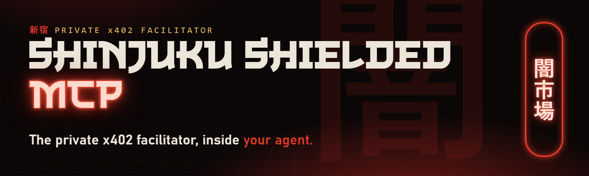

<p align="center"></p>

<p align="center">


</p>

# Shinjuku Shielded MCP

The private x402 facilitator, inside your agent.

Shinjuku Shielded settles x402 payments from a shielded USDC balance on
Solana: on chain, a shielded payment does not show who paid. This MCP server
is how your agent uses it. It runs on your machine, under caps that only you
set.

- **Self-custody.** The server runs on your machine. Your keys never leave
  it. We never run it, and we never hold your money.
- **Shielded payments.** Your agent pays from a shielded balance. Add `--tor`
  and no server sees your IP.
- **One command to set up.** `npx -y --no-audit --no-fund shinjuku-shielded setup` makes the
  wallet, a private passphrase file, and the checked proof tools, and writes
  `config.json`. Then your agent host starts `npx -y --no-audit --no-fund shinjuku-shielded mcp`.
  `--no-audit --no-fund` stop npx from asking npm's audit and funding
  services when it installs a new version. Once, that request held the start for
  5 minutes.
- **Add funds from 0.01 USDC.** Ask your agent to add funds.
  `wallet_add_funds` gives a one-time address. Send USDC to it from any
  wallet or exchange, and it becomes private by itself.
- **Caps that only you set.** Spending limits are optional; by default there
  is none (only the balance bounds a payment). Setup records the ones you set.
  A tool call can only lower them, never raise them.
- **Find sellers.** `x402_discover` searches public x402 listings
  (Coinbase x402 Bazaar, PayAI, Dexter, and others) on your machine.
- **Pay any Solana `exact` seller.** A seller on Coinbase CDP, PayAI, or any
  other facilitator is paid through Shinjuku: your wallet pays us privately,
  and we pay the seller from our own float. Nothing to fill or set aside.
- **Look before you pay.** `x402_preview` shows the price and whether your
  caps allow it. It pays nothing.
- **No SOL.** `wallet_add_funds` and `wallet_shield` need only USDC. Our
  facilitator's relayer pays the network fee.
- **Never twice.** A retry with the same `request_id` resumes the same
  payment, deposit, or unshield. It never starts a second one.
- **No RPC, no account, no API key.** Reads go through our relay by default.
  Your own RPC always wins if you give one.

Every Shinjuku Shielded service joins this MCP as it ships.

The server is the `mcp` command of `shinjuku-wallet`, one file. This
repository holds the setup guide and [examples](examples/). The wallet file, its SHA-256, and its
release history are in
[ShinjukuStaition/shinjuku-shielded](https://github.com/ShinjukuStaition/shinjuku-shielded).

## Talk to it in plain words

Ask your agent the way you would ask a person:

| You say | Your agent calls |
|---|---|
| "what is my balance" | `wallet_balance` |
| "add 0.50 USDC to my shielded balance" | `wallet_add_funds` |
| "shield 5 USDC" | `wallet_shield` |
| "find a seller of satellite images" | `x402_discover` |
| "pay this URL" | `x402_preview`, then `x402_pay` |
| "ask an AI model privately" | `inference_chat` |
| "send 2 USDC privately to <address>" | `wallet_unshield` |
| "sell my JUP and send the value privately to <address>" | `wallet_transfer_token` |

Each answer tells the agent the exact next call. The wallet reads the chain
and writes an encrypted backup by itself, so you never run a command for
upkeep.

## Tools

### SETUP

On a machine with no wallet, the server starts in setup mode.

| Tool | What it does |
|---|---|
| `shinjuku_setup` | Asks you to confirm in your MCP client that it may create a Shinjuku Shielded wallet on this machine, and shows the caps. Then it runs the setup and switches the same server to the wallet tools. It never asks for a secret. A client that cannot ask is told to run `npx -y --no-audit --no-fund shinjuku-shielded setup` in a terminal. |
| `wallet_status` | Says whether the wallet is set up, and what to do next. |

In setup mode, every money tool answers `wallet_not_set_up` and does
nothing.

### FUND

| Tool | What it does |
|---|---|
| `wallet_add_funds` | Gives a new one-time Solana address of this wallet and a `solana:` pay link. Send USDC to it from any wallet or exchange, from 0.01 USDC. You need no SOL. A few minutes after the USDC arrives, it becomes private by itself while the MCP server runs. One round takes up to 5 USDC; a larger amount goes in by rounds. Use each address for one payer. The call itself moves no money. |
| `wallet_shield` | Moves USDC that is already on the wallet's own Solana key into your shielded balance: any amount from 0.01 USDC, while the shielded balance stays at most 5 USDC. It is a public step: the chain shows the wallet's own key. It is on with `--proof-tools`. `--no-shield` turns it off. Funding takes minutes: the first call starts it and returns a stage. Call again with the same `request_id` to see the stage. It never starts a second deposit. When the deposit lands, the wallet reads it from the chain and writes an encrypted backup. The wallet's own key needs the USDC and no SOL: our facilitator's relayer pays the network fee, and you pay the shield cost. |

### PAY

| Tool | What it does |
|---|---|
| `x402_discover` | Searches public x402 listings (Coinbase x402 Bazaar, PayAI, Dexter, and others) on your machine and returns the sellers that match. Pays nothing. The first call takes about 15 s. |
| `x402_preview` | One unpaid request. Returns the seller's price, the scheme, and whether your caps allow it. Pays nothing. For a standard `exact` seller it adds `feeAtomic` (our fee) and `totalAtomic` (price plus fee, what leaves your balance). A seller that lists several networks is priced from its Solana offer. |
| `x402_pay` | Pays the URL (if it asks for payment) and returns the answer. A URL that does not answer 402 is fetched once and nothing is paid. An image answer (image bytes, or JSON `image_base64`) comes back as an MCP image block, and the file is saved. A payment that landed, from a seller that gives no answer, closes as paid. If a standard `exact` seller does not take our payment, the answer is `p03_float_refund_pending`: price and fee come back to your balance by themselves within about 7 minutes. Alias: `fetch_paid`. |
| `inference_chat` | One AI answer from usePod's x402 chat endpoint, paid privately from your shielded balance. A short `qwen3-8-flash` answer costs about 0.0011 USDC: the provider price plus the 0.001 USDC Shinjuku fee. It needs `--tor` or a proxy. |

### UNSHIELD

| Tool | What it does |
|---|---|
| `wallet_unshield` | Sends shielded USDC to a public Solana address. It is on with `--exit-proof-tools` and `--profile`. Our facilitator pays every network fee. The same `request_id` never unshields twice. An address that you named with `--unshield-to` is sent at once. Any other address is sent only after you confirm it in your MCP client: "Send X USDC from your shielded balance to <address>?". A decline, or no answer in 5 minutes, sends nothing. A client that cannot ask is refused, so a prompt injection cannot pick an address by itself. The wallet's own key is refused: it made the deposits, so an exit there would link them. |

### ACCOUNT

| Tool | What it does |
|---|---|
| `wallet_balance` | ONE balance (`balanceAtomic`, what `x402_pay` can spend) and UNSHIELDED (`unshieldedAtomic`, plain USDC on the wallet's own Solana key), with `ownAddress` and `status` (`"current"` when the balance is read). `breakdown` names the parts of the one balance: `shieldedAtomic` (what `wallet_unshield` can send), `refundsInFlightAtomic` (a Shinjuku refund on its way back), and `setAsideAtomic` (value in pockets of an older version). A stale balance is read from the chain first. UNSHIELDED is one network read; if it fails, that line is empty and says why. |
| `wallet_receipts` | Your most recent paid receipts: `{ok, count, total, facilitatorNote, receipts}`. Each receipt has `kind` (`x402`, `inference`, or a move), the host (never the full URL), `amountAtomic`, and `transaction`. |
| `wallet_cancel` | Closes one unfinished payment (its reserved balance comes back), the parts of a private send that did not start, or an add-funds link that no USDC reached. |

### RECEIVE AND TRADE

| Tool | What it does |
|---|---|
| `wallet_receive_shielded` | Gives a new one-time private (shielded) address of this wallet, for a Shinjuku Shielded payer in the same pool. It stores, signs, and moves nothing. A wallet that never shielded can spend what it receives only after one shield; the answer says so in `notice`. |
| `wallet_transfer_token` | Sells a Solana token for USDC (on Jupiter), makes the USDC private, and sends it privately to an address. The address gets USDC, not the token. It takes minutes. The stages are `selling`, `shielding`, `sending`, and `done`. |
| `wallet_transfer_token_status` | Shows the stage of one transfer by `request_id`, or the list of transfers. |

`wallet_shield` and `wallet_unshield` always appear in the tool list. When
one is off, it answers `"error": "mcp_tool_disabled"` and tells the agent
what to ask you.

The tool list shows 12 of the tools above: `wallet_receive_shielded` is not
in the list from 0.3.54 (it comes back with private escrow deals), but it
still answers when an agent calls it by name. Some older tools are not in
the list either, and they also answer by name:
`wallet_shield_from_elsewhere`, `wallet_pay_me`, `wallet_pay_me_status`,
`wallet_unshield_cancel`, `wallet_move_status`, and `inference_models`.

What it pays:

- **`shielded-exact`**, from your shielded balance, whenever the seller
  offers it.
- **Standard Solana `exact`, through Shinjuku (float pay).** For a seller on
  any facilitator (Coinbase CDP, PayAI, or any other), `x402_pay` pays us
  privately from your shielded balance: the seller's price plus a flat fee
  (`feeAtomic`, 0.001 USDC on 2026-10-22). We pay the seller at once from our
  own shared float. The chain shows Shinjuku paying the seller, never your
  wallet. `max_payment_atomic` must cover price plus fee. The largest price
  that one request can pay is `largestAtomic` in
  `GET https://pay.shinjukustaition.com/api/x402/float/config` (10 USDC on
  2026-10-22).
- A retry with the same `request_id` never pays twice.

Hidden amounts (scheme `confidential`, the V0b vault) are retired: the V0b
program was closed on chain on 2026-10-11.

Value that an older version put in pockets still counts in the one balance.
When the server has `--proof-tools`, `--exit-proof-tools`, and `--profile`,
it returns that value to the shielded balance by itself while it is idle.
`shinjuku-wallet pocket reshield` does the same by hand.

A balance split over several accounts: one payment spends one account plus
at most 3 notes. The server joins the accounts into one by itself (a private
payment to itself; nothing leaves the shielded balance, and our facilitator
pays the network fee). When no single account covers a price yet, `x402_pay`
says so, the join starts within about a minute, and the answer says when to
pay again.

## Privacy modes

| | Default | `--tor` |
|---|---|---|
| On chain | A shielded payment does not show who paid. | The same. |
| Your IP | Payments go to `pay.shinjukustaition.com`, with no CDN in the path. Our server sees your IP. It keeps no access logs. | Hidden from everyone, us included. |
| The seller | Sees your IP. | Does not see your IP. |
| Speed | Faster. | About 1-2 s slower per request. |
| Needs | Nothing extra. | Tor with `HTTPTunnelPort 127.0.0.1:9080 IsolateDestAddr` in `torrc`. |
| When a path is slow | - | The wallet races our onion addresses and keeps the first that answers. A facilitator onion that gives no answer in 15 s brings in two spare onions. A history request with no answer moves to the next history onion, and a history source that is silent for 60 s ends with a plain error instead of a long wait. A stalled Tor circuit is replaced. A facilitator request never falls back to our clearnet address. |

## Setup

You need Node.js 22.21 or later (or Node.js 24 or later), on Linux, or on Windows with WSL. macOS is not
supported: the provers are Linux programs.

To update, run `npx -y --no-audit --no-fund shinjuku-shielded@latest setup` once; your wallet, its
address, and its balance stay the same.

### 1. Run the setup in a terminal

```sh
npx -y --no-audit --no-fund shinjuku-shielded setup
```

It asks for the caps (Enter keeps the default) and Tor. `--yes` asks
nothing. `--add-to claude-code` (or `claude-desktop`, `cursor`) also adds
the server to that host's config. In our runs, setup took about 10-16 s on a
fast line, with the proof-tool download of about 191 MB. Over Tor (`--tor`),
it took 77 s in our last test (0.3.63, 2026-10-22). At the end it prints a
summary, for example:

```
Shinjuku Shielded is set up.
  limits       no limit per payment, no limit in any 24 hours, no limit for the life of the wallet
  config       <home>/config.json
  passphrase   <home>/passphrase.txt (a new random passphrase; only you can read the file; it is never printed)
  proof tools  <home>/proof-tools/a9af32df (29 files downloaded, every hash checked)
  wallet       created; your public address (solanaFeePayer): <address>
  recovery     <home>/recovery-<time>.txt
```

Setup writes to `~/.carbon-shielded-wallet` (or `SHIELDED_WALLET_HOME`):

- The wallet, and a recovery file with the seed and the key. Copy the
  recovery file to two offline places, then delete it from this machine.
- `passphrase.txt`: a new random passphrase, readable by you alone. It is
  never printed, and no tool takes or returns it. Keep it: the wallet file
  opens only with it.
- The proof tools. Setup checks every file against the set that this wallet
  release pins.
- `config.json`: the caps, the paths, and Tor. With it, `mcp` needs no
  flags. A flag on the command line still wins.

Spending limits are optional and off by default: with none, only the balance
bounds a payment. To set them, give `--max-payment`, `--max-session`, or
`--max-cumulative`, in USDC (`0.05` = 5 cents). A setup rerun lifts the
old default caps (0.05 / 1 / 20 USDC) of earlier versions. `--prefer-tor`
records Tor (see Privacy modes).

You can run `setup` again at any time. It never changes an existing wallet,
and it checks every proof-tool file again.

### 2. Add the server to your agent host

If you gave `--add-to`, this step is done. Setup also prints these lines.

Claude Code:

```sh
claude mcp add --scope user shinjuku-shielded -- npx -y --no-audit --no-fund shinjuku-shielded mcp
```

On native Windows, the line that setup prints puts `cmd /c` before `npx`.
With a wallet folder that is not the default, it adds
`-e SHIELDED_WALLET_HOME=<home>` (or an `"env"` block in JSON).

Claude Desktop (`claude_desktop_config.json`), Cursor (`~/.cursor/mcp.json`),
and other JSON-config hosts:

```json
{
  "mcpServers": {
    "shinjuku-shielded": {
      "command": "npx",
      "args": ["-y", "--no-audit", "--no-fund", "shinjuku-shielded", "mcp"]
    }
  }
}
```

### Or: start the server first and accept the setup

You can also add the server first, with no wallet on the machine. Then the
server starts in setup mode. Ask your agent "what is my balance". Your MCP
client asks you to confirm: create a Shinjuku Shielded wallet on this
machine. Accept, and the setup runs (with the proof-tool download of about
191 MB). Then the same server switches to the wallet tools. You do not
restart it. A client that cannot ask is told to run
`npx -y --no-audit --no-fund shinjuku-shielded setup` in a terminal.

In a terminal, `npx -y --no-audit --no-fund shinjuku-shielded mcp` asks
"Set up Shinjuku Shielded now? (y/n)".

### 3. Add funds

The wallet starts empty. Ask your agent "Add 0.50 USDC to my shielded
balance". It calls `wallet_add_funds` and gives a one-time address. Send
that USDC on Solana from any wallet or exchange. Amounts from 0.01 USDC
work, and you need no SOL. The USDC becomes private by itself while the MCP
server runs: our relayer pays every fee.

From an exchange, in a terminal, whole USDC only:

```sh
npx -y --no-audit --no-fund shinjuku-shielded add-funds --route exchange --amount 2
```

It prints a one-time address. Withdraw exactly that amount of USDC (Solana
SPL) from the exchange to it, and it shields the USDC by itself. `--amount`
is a whole number of USDC (`2` = 2 USDC).

USDC that is already on the wallet's own address (`ownAddress` in
`wallet_balance`) goes in with `wallet_shield`. The steps are in
[First 10 minutes](examples/README.md#first-10-minutes).

### Advanced: download the file and check it

Download the release file and check its SHA-256 before you run it. The
current file and hash are also in the
[Releases table](https://github.com/ShinjukuStaition/shinjuku-shielded#releases)
and in section 7b of https://shinjukustaition.com/skill.md.

```sh
curl -fsSLO https://shinjukustaition.com/wallet/b840ab22/shinjuku-wallet.mjs
echo "b840ab22b761c3a08caa1fc73f7e9d0b4ae0139a21aeca10fdf71086a0092704  shinjuku-wallet.mjs" | sha256sum -c -
node shinjuku-wallet.mjs setup
```

With the file, replace `npx -y --no-audit --no-fund shinjuku-shielded` with
`node /abs/path/shinjuku-wallet.mjs`. To pin the npm version, write
`shinjuku-shielded@0.3.78`.

### Advanced: flags instead of config.json

`mcp` reads `config.json` only when you give no `--pool` and no `--wallet`.
To give the flags yourself (for example, for a wallet that you made with
`init` before 0.2.0):

```sh
claude mcp add --scope user shinjuku-shielded -- npx -y --no-audit --no-fund shinjuku-shielded mcp \
  --max-payment 0.05 --max-session 0.2 --tor \
  --pool <pool> \
  --program 8PYPw3FSFTMbvSneXdcoH6jNoN4VD23nHwPY2A2riUy1 \
  --memo-service https://pay.shinjukustaition.com \
  --proof-tools /abs/path/shinjuku-proof-tools/proof-tools.json \
  --exit-proof-tools /abs/path/shinjuku-proof-tools/exit-proof-tools.json \
  --profile /abs/path/shinjuku-proof-tools/public-profile.json \
  --passphrase-file /abs/path/passphrase.txt
```

With `--pool`, `--program` and `--memo-service` are required. Setup writes the pool, the program, and the
facilitator into `config.json`: `<pool>` is the pool in your `config.json`.
`npx -y --no-audit --no-fund shinjuku-shielded help mcp` prints every flag.

Use absolute paths: a host starts the server from its own folder. On Windows,
write `C:/Users/you/...`. `--proof-tools` turns `wallet_shield` on.
`--exit-proof-tools` and `--profile` turn `wallet_unshield` on.

For an older wallet, you can also run `setup` once with
`SHIELDED_WALLET_HOME` set to your wallet folder and `--passphrase-file`
set to your passphrase file. It keeps your wallet and writes `config.json`
beside it.

A send to a new address needs a host that supports MCP elicitation (it shows
you the confirmation). With a host that does not, name each address with
`--unshield-to`.

## Examples

[examples/](examples/) has complete configs and a walkthrough:

- [Claude Code](examples/claude-code.md): the setup command, the
  `claude mcp add` command, Tor, each flag explained, and how to check it
  works.
- [Claude Desktop](examples/claude-desktop.json) and
  [Cursor](examples/cursor.json): complete JSON configs.
- [Hermes Agent](examples/hermes.md): the `config.yaml` entry.
- [Vercel AI SDK](examples/vercel-ai-sdk.md): the server's tools in
  `generateText` through `@ai-sdk/mcp`, with no other package.
- [Solana Agent Kit](https://github.com/ShinjukuStaition/shinjuku-sak-plugin):
  npm `solana-agent-kit-plugin-shinjuku`, the wallet as Solana Agent Kit v2
  actions.
- [First 10 minutes](examples/README.md#first-10-minutes): set it up, add
  the server, add funds, pay, send, and check the balance.
- [Plain requests](examples/prompts.md): 13 requests, the tool each one
  calls, and the shape of the answer.

## Caps and flags

After setup, `config.json` holds the caps and the paths. You can add any of
these flags to the `mcp` command. A flag wins over `config.json`.

| Flag | |
|---|---|
| `--max-payment <usdc>` | Optional. The most one payment may cost, in USDC (`0.05` = 5 cents). Setup records it. Default: no limit. |
| `--max-session <usdc>` | Optional. The most this wallet may pay in any 24 hours, from every MCP process together. When you set both, it must be at least `--max-payment`. Setup records it. Default: no limit. |
| `--max-per-host-day <usdc>` | Optional. The most one seller host may receive in 24 hours, in USDC. |
| `--allow-host <host>` | Optional, repeatable. Pay only these seller hosts. |
| `--no-shield` | Optional. Turns `wallet_shield` off. It is on with `--proof-tools`. |
| `--max-shield <usdc>` | Optional. The most one shield call may move, and the most this wallet may shield in any 24 hours, in USDC. Without it, no cap beyond the balance. |
| `--allow-shield` | Accepted for older configs. `wallet_shield` is on without it. |
| `--exit-proof-tools <file>`, `--profile <file>` | Optional. Turn `wallet_unshield` on (with `--proof-tools`). |
| `--unshield-to <address>` | Optional, repeatable. These addresses receive with no confirmation. Any other address needs your confirmation in the MCP client. The wallet's own key is refused: the server does not start when you name it here. |
| `--ready-pockets <0-5>` | Accepted for older configs and ignored. Standard `exact` sellers are paid through Shinjuku, and the wallet fills no pocket. |
| `--no-auto-pockets` | Accepted for older configs. It also stops the idle return of old pockets to the shielded balance. |
| `--max-unshield <usdc>` | Optional. The most one unshield call may move, and the most this wallet may unshield in any 24 hours, in USDC. Without it, a send you confirm can move the whole shielded balance. |
| `--no-tor` | Optional. This run does not use the Tor that setup recorded. |
| `--tor` | Optional. Every request goes through Tor; our facilitator is reached over its onion service. Needs Tor with `HTTPTunnelPort 127.0.0.1:9080` in `torrc`. See Privacy modes. |
| `--rpc-file <file>` | Optional. Your own Solana RPC URL. Without it, reads go to our relay, which sees which accounts the wallet reads. |

The passphrase comes from `--passphrase-file` or `SHIELDED_WALLET_PASSPHRASE`
at start, never from a tool call. A refusal is a normal answer
(`{"ok": false, "error", "detail", "next"}`); the agent does what `next`
says. A cap refusal tells the agent to ask you: only you set the caps.

An unshield is your own money, so it does not count against the payment
budget of the wallet file (`init --max-payment`, `--max-cumulative`).
Payments to sellers still count. To show, change, or remove those
wallet-file caps, run `shinjuku-wallet limits` (`none` removes a cap). A
refusal by one of them tells the agent to ask you for this.

Upkeep is automatic. After a deposit lands, and before a payment or unshield
when the local balance is stale, the server reads the chain itself. By
default it reads the pool history through our facilitator's https history
proxy: a new wallet is ready in about 60 s. After
each shield and unshield, the wallet writes an encrypted backup to
`<SHIELDED_WALLET_HOME>/auto-backups/<pool>/`. It keeps the newest 5
complete, verified backups. They are on the same disk as the wallet: copy
one to another place.

## What others can see

- The seller sees your request, the price, the time, and your IP unless you
  use `--tor`.
- Your agent host and its model provider see every URL, body, price, paid
  answer, amount, and unshield address the agent handles. A local model
  removes that observer.
- Your MCP client app (Claude Code, Claude Desktop, Cursor, ...) answers the
  confirmation of a send, not the model. So a prompt-injected agent cannot
  approve a send. But the wallet trusts the client app to show the dialog to
  you: a malicious or modified client app could answer "accept" by itself.
  For a strict setup, name your addresses with `--unshield-to` and use a
  client without elicitation. Then any other address is refused.
- Our facilitator processes your payment. It keeps no access logs.
- On chain, a `shielded-exact` payment does not show who paid. A float pay
  payment is a pool payment to us (the payer hidden), then a normal USDC
  transfer from a Shinjuku float pocket to the seller. Many buyers pay from
  the same float pockets. The transfer lands seconds after the pool payment,
  so time can pair the two.
- For a float payment, our server sees which private payment paid which
  seller, the price, the URL, and the time, until the payment is final or
  refunded. It does not see your wallet.
- `wallet_add_funds`: the chain shows the USDC that arrives at the one-time
  address, the amount, and the time. Use each address for one payer.
- `wallet_shield` is a public step: the chain shows USDC leave the wallet's
  own key, the amount, and the time.
- `wallet_unshield` is a public step: the chain shows the amount, the
  address that receives it, and the time.
- `inference_chat`: usePod and the model provider see the prompt and the
  answer.
- The UNSHIELDED line of `wallet_balance` reads the wallet's own key. The RPC
  (our relay by default) sees which key it reads.
- Privacy needs a crowd. With few users, timing can still link payments.

## Status

Listed in the official [MCP Registry](https://registry.modelcontextprotocol.io/v0/servers?search=io.github.ShinjukuStaition/shinjuku-mcp)
as `io.github.ShinjukuStaition/shinjuku-mcp`. npm: [`shinjuku-shielded`](https://www.npmjs.com/package/shinjuku-shielded),
published from this repository's workflow with npm provenance (from 0.1.1).

Live on Solana mainnet. The current wallet release is `b840ab22` (npm
0.3.78, 2026-10-23). New in 0.3.78:

- `wallet_receipts` shows the private transaction of every payment, also
  when the app ended the wallet right after the payment.
- A token transfer reports its progress in fewer, slower answers, names the
  exact SOL it needs, and sends a total rounded down to 0.01 USDC. The rest
  stays in your private balance, so the parts do not match the sale.
- A balance split into parts joins by itself across sessions, and the
  balance answer says when a send of everything must join parts first.
- Limit refusals say how to raise the limit, and where.
- Each payment, shield or send answer gives your new balance, and "show my
  wallet" gives a short wallet card.
- `npx -y shinjuku-shielded version` prints the version (npx answers
  `--version` itself), and MCP apps show the real version.

Every release and its changes: [CHANGELOG.md](CHANGELOG.md).

Float pay paid two stock sellers on the PayAI facilitator on
production on 2026-10-11, 0.10 USDC and 1.50 USDC, and a stock seller on our
own facilitator, 0.01 USDC twice: the transactions are in
[proof.md](https://github.com/ShinjukuStaition/shinjuku-shielded/blob/main/docs/proof.md).

These transactions were made with real money through this MCP
server, against our production facilitator, on an earlier pool (retired
2026-10-10). The first two came from a new wallet with the default
setup and no SOL at any time (wallet release `94a357bc`). The others used
wallet release `1a336885` (2026-10-08).

| Tool | Transaction |
|---|---|
| `wallet_shield` (no SOL) | [`5np1EYjN…fH2`](https://solscan.io/tx/5np1EYjNkr5w7Tt6ng2KQ9cp7RgNkhpwAKtzkm2nyRKMgi1FsmM3TMZMx8EkyiAV4sUtoQ3mTtTbuehas1qV3fH2) |
| `x402_pay` to a public satellite-imagery seller (0.013 USDC, JPEG answer in 8 s) | [`iC6gnjFM…DHwC`](https://solscan.io/tx/iC6gnjFMBwHaqArgcRL6C5GdNbcWMom82cZqcQ2C2xup9aXJX91HXmWozQcVvAyTSTZsRptynfdbBPjjxG9DHwC) |
| `wallet_shield` (1 USDC in) | [`hWzDiR1R…izn`](https://solscan.io/tx/hWzDiR1RnC1gFXMMrCxRBCZ4R5dgMreWGX7vyQCTUTWkKaKnYvxmro6PQuE9KMYVbrq3NkNu9YaJzj7XaqrDizn) |
| `wallet_unshield` (0.5 USDC out) | self-pay [`5evVHz8X…r9uv`](https://solscan.io/tx/5evVHz8XvMdSYF76BQ1xv3TazwS9P38FEXp81gipNMMSqn61Rj7EUc1DdgpYz591wQbBZMWcpNVznixXPsfZr9uv) · exit [`4yY2YXLS…pgF2i`](https://solscan.io/tx/4yY2YXLSj1EyUWDb7X9985KmyeNGQieF8skg3uN3sv3Pds3zSb42J5owDWMUTshui6XACkP4zwGxUmXXTVapgF2i) |
| `wallet_unshield` with your confirmation (0.25 USDC, release `1a336885`) | self-pay [`3jQyPgrA…QEWw`](https://solscan.io/tx/3jQyPgrA5AtFcqzyWHDWRcfNv66sM5qfCStxsByYDqGm7W5uRWkUMHpLoFUFm2jc98Aor7CXSToAChSHD7dWQEWw) · exit [`4yA3qkHU…jCoh`](https://solscan.io/tx/4yA3qkHUto7e7iUGM9q6321avTm8aZQJ6zNMMh18SoAACnvgtvbWpVydry3mCq9iKaSZv92FfH43NJu557zjCoh) |
| `x402_pay` (pocket `exact`, before float pay) | [`kX2zbbuR…8wW`](https://solscan.io/tx/kX2zbbuRbskBQ2EnazyDBu7oZ7BtySVT7zDmtBn7ZivMm3guhLWrJGiPFFLzTEyxwTKUkeSAJjTJLSWLHYP48wW) |

No unshield transaction contains the wallet that shielded; our facilitator
paid every network fee of each unshield.

Full guide: https://shinjukustaition.com/skill.md ·
Onion: http://2kfhlfuyuwvhmibjrpxqsg4nrbcxasjgjq7kmnfzgfwzptkhhznz3dad.onion/skill.md ·
X: [@Shin_StAItion](https://x.com/Shin_StAItion)
