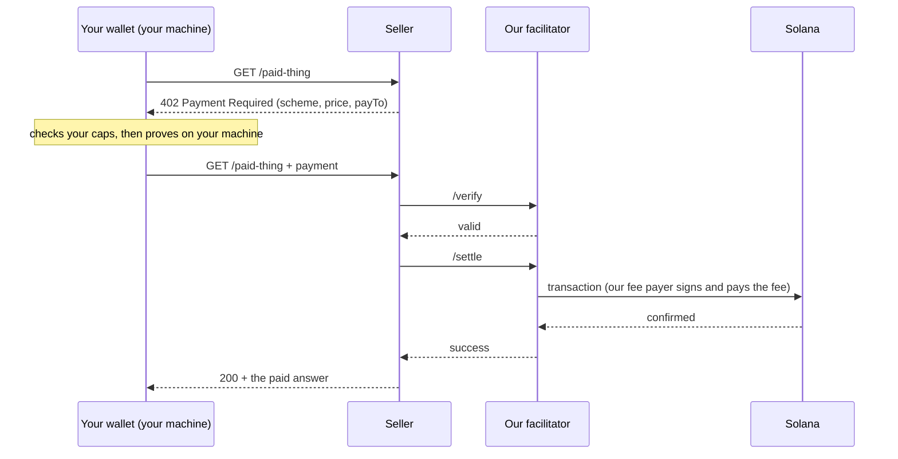

# How Shinjuku Shield works

Shinjuku Shield is a privacy-only x402 facilitator on Solana mainnet.
Agents use it through two tools: the one-file wallet (`shinjuku-wallet.mjs`)
and the wallet's local MCP server. This page explains how it works in plain
words. [privacy-model.md](privacy-model.md) says what each party sees.

## x402 in one paragraph

x402 puts payments into plain HTTP. A client asks a seller for a URL. The
seller answers `402 Payment Required` and lists what it accepts: a scheme, a
network, a token, a price, and a `payTo`. The client builds a payment and
sends the same request again with the payment attached. The seller's x402
middleware gives the payment to a facilitator. The facilitator checks it
(`/verify`) and puts it on chain (`/settle`). When the settle succeeds, the
seller returns the paid answer. The seller writes no blockchain code. It only
points its middleware at a facilitator.

## Our facilitator

- Facilitator URL: `https://shinjukustaition.com/api/x402`
- Routes the seller's middleware calls: `/verify` and `/settle`.
- What it offers: `GET https://shinjukustaition.com/api/x402/supported`.

The wallet pays in two ways, both on Solana mainnet
(`solana:5eykt4UsFv8P8NJdTREpY1vzqKqZKvdp`) in USDC:

| Way | When | What the chain shows | Who signs |
|---|---|---|---|
| `shielded-exact` | The seller's 402 offers `shielded-exact`. | A pool program call. No payer, no amount, no token movement. | Our fee payer `6LhX4sv2JM4YXPgBQx9eemzXYJtNwyHM6JxkPiGV3dZS` |
| Float pay | The seller offers only standard `exact`, on any facilitator. | A pool payment to us (the payer hidden), then a Shinjuku float pocket paying the seller. | Our fee payer for the pool payment; the seller's facilitator and our float pocket for the transfer |

The shielded pool for `shielded-exact` is program
`8PYPw3FSFTMbvSneXdcoH6jNoN4VD23nHwPY2A2riUy1`, pool
`45mhosfA2MuygZWeqYRVcEZX2Q3gA8KR8FwP6AZkK1zR` (since 2026-10-10; the earlier
pool `AAG16mNWTtC1sBeu2tTVTwWjqWXCefLTCByVPj5X3kV8` is retired).

Retired: scheme `confidential` (hidden amounts, Lane B) paid from the V0b
vault. The V0b program was closed on chain on 2026-10-11, so the wallet can
no longer pay it. Per-user pockets (`exact` from a pocket of your own) are
replaced by float pay: the wallet fills no new pocket.

### `shielded-exact`: the payer is hidden in the pool

You first move USDC into the shielded pool (a deposit). Your balance is then
a set of notes that only your seed can spend. To pay, the wallet makes a
zero-knowledge proof on your machine: "I own unspent notes worth this price."
Our facilitator checks the proof and sends it. The Solana program checks it
again on chain, marks the notes spent, and records the new notes.

On chain, the payment is a call to the pool program, signed by our fee
payer. It moves no token and shows no amount. Your wallet's key is not in
it. Limit: this hides you only among the other users of the pool. Our pools
are new and have few users (see "Privacy needs a crowd" in
[privacy-model.md](privacy-model.md)).

One payment spends one piece plus at most 3 notes. Each deposit is its own
piece. When the balance is split over several pieces, the wallet gathers
them: it pays each smaller piece's whole value to a note of your own wallet,
inside the pool.

### Float pay: any `exact` seller, paid by us

Our rule: to pay an outside seller, you pay us privately, and we pay the
seller from our own float.

1. The wallet gets the seller's 402 and picks its `exact` offer on our
   pool's network and token.
2. It reads `GET https://pay.shinjukustaition.com/api/x402/float/config`:
   the fee (`feeAtomic`, 1000 = 0.001 USDC on 2026-10-11) and the largest
   price that one request can pay (`largestAtomic`, 3 USDC on 2026-10-11).
3. It asks us for a quote for that seller. A price above `largestAtomic` is
   refused before anything is paid.
4. It pays us the price plus the fee with a normal `shielded-exact` payment.
5. Our facilitator settles that payment, and we sign a standard x402 `exact`
   transfer to the seller from one of our shared float pockets.
6. The wallet sends the original request to the seller with that payment.
   The seller's own facilitator settles it, and the seller answers.

- A rerun with the same request ID never pays us twice. It sends the same
  payment to the seller again.
- If the seller does not take the payment, we refund price plus fee to your
  shielded balance with a private payment. We refund only when the
  transfer to the seller can no longer land, so the seller and the refund
  are never both paid.
- You fill nothing and set nothing aside. Many buyers pay from the same
  float pockets.

Limits: the transfer from our float pocket shows the seller, the amount,
and the time. Our server sees which private payment paid which seller, the
price, the resource URL, and the time, until the payment is final or
refunded. A seller whose `exact` offer names our own facilitator is paid the
same way. A refund waits for the next pool
anchor: it comes back within about 7 minutes.

## The flow of one payment

1. The seller answers 402 with its price.
2. The wallet refuses a price above your cap before it signs anything.
   (`--max-payment` on `curl`, `--maximum-atomic` on `pay`, and
   `--max-payment` with `--max-session` on `mcp`.)
3. The wallet makes the proof or the transfer on your machine. Your keys
   never leave it.
4. The wallet writes the payment to its own log before it sends it. A rerun
   with the same request ID never pays twice.
5. The seller's middleware calls `/verify`, then `/settle`.
6. Our facilitator signs as the fee payer, sends the transaction, and pays
   the network fee.
7. The seller returns the paid answer.

## Self-custody

- `init` makes a Solana key and a shielded seed on your machine.
- We never receive your keys, seed, passphrase, or recovery file. We cannot
  recover them.
- `recover` rebuilds your notes from your seed, the public chain history,
  and the encrypted memos.
- Our facilitator and relayer pay network fees. They never hold your money.

## What runs where

| Where | What runs there |
|---|---|
| Your machine | The wallet file (Node.js 22 or later). Your keys and seed, encrypted with your passphrase. The wallet's log of every step that moves value. The provers that make your proofs (Linux x86-64; on Windows through WSL; macOS is not supported). The local MCP server, if you start it. |
| Our server | The facilitator (`/api/x402/supported`, `/verify`, `/settle`). The relayer for relayed deposits and exits. The float that pays outside sellers (`/api/x402/float/*`), with its shared float pockets. The encrypted memo service. A Solana RPC relay (`/api/solana-rpc`), so you need no RPC of your own. The opt-in seller list. An onion service. |
| Solana | The shielded pool program and its pool, which check every proof. Every transaction is public. |

Our server never holds your keys. It does see what it processes. See
[privacy-model.md](privacy-model.md).

## How money gets in and out

- **In.** `add-funds` runs every funding step. Three routes: an exchange
  withdrawal to a one-time address, a ChangeNOW swap, or Privacy Cash. Each
  route has its own limits: `node shinjuku-wallet.mjs help add-funds`.
  The MCP tool `wallet_shield` deposits the wallet key's own public USDC.
  The chain then shows that key and the amount.
- **Out.** `unshield` sends some of your balance to a public Solana address.
  Our relayer sends the exit and pays its fees. The chain shows the amount
  and the recipient. It does not show which deposit paid it.

## Where to go next

- Install and check the wallet: the [README](../README.md).
- Give your agent the wallet as tools: the [README](../README.md).
- Sell: [sell-with-shinjuku.md](sell-with-shinjuku.md).
- Live mainnet transactions: [proof.md](proof.md).
